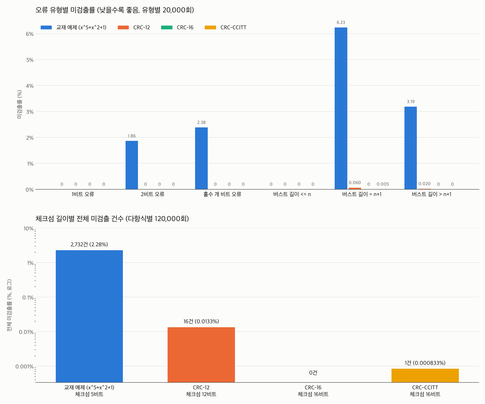

# CRC

A computer-networks assignment: implement cyclic redundancy check encoding and checking with modulo-2 division, reproduce the textbook example step by step, then inject errors and measure how often four generator polynomials detect them.



## Problem

CRC theory says which errors a generator is guaranteed to catch (all single-bit errors, all odd-count errors if the generator has an x+1 factor, all bursts up to the checksum length). The assignment checks those guarantees against simulation instead of taking them on faith.

## Approach

- `crc.py`: polynomial ↔ bit string, modulo-2 division with a printed long-division trace, `encode` and `check`.
- `main.py`: reproduces the textbook example, then for 64-bit random data runs 20,000 trials per error type (1 bit, 2 bits, odd count, burst ≤ n, burst = n+1, burst > n+1) with a fixed seed (2026).
- `plot_crc.py`: draws detection rates per generator.
- Generators: the textbook x⁵+x²+1, CRC-12, CRC-16, CRC-CCITT.

## Results

Detection rate, 64-bit data, 20,000 trials per error type, seed 2026:

| Error type | x⁵+x²+1 | CRC-12 | CRC-16 | CRC-CCITT |
|---|---|---|---|---|
| 1 bit | 100.000% | 100.000% | 100.000% | 100.000% |
| 2 bits | 98.140% | 100.000% | 100.000% | 100.000% |
| Odd count | 97.620% | 100.000% | 100.000% | 100.000% |
| Burst ≤ n | 100.000% | 100.000% | 100.000% | 100.000% |
| Burst = n+1 | 93.765% | 99.940% | 100.000% | 99.995% |
| Burst > n+1 | 96.815% | 99.980% | 100.000% | 100.000% |

Full console output of the run: [results.txt](results.txt).

## Tech stack

Python, matplotlib

## Run

```bash
python main.py
```

## Lessons learned

- The textbook generator x⁵+x²+1 has no x+1 factor, and it is the only one that misses odd-count errors (97.620%), as the theory predicts.
- Every generator caught every burst no longer than its checksum, and every single-bit error.
- "100%" here means no miss in 20,000 trials, not a proof; the guarantees come from the algebra.
